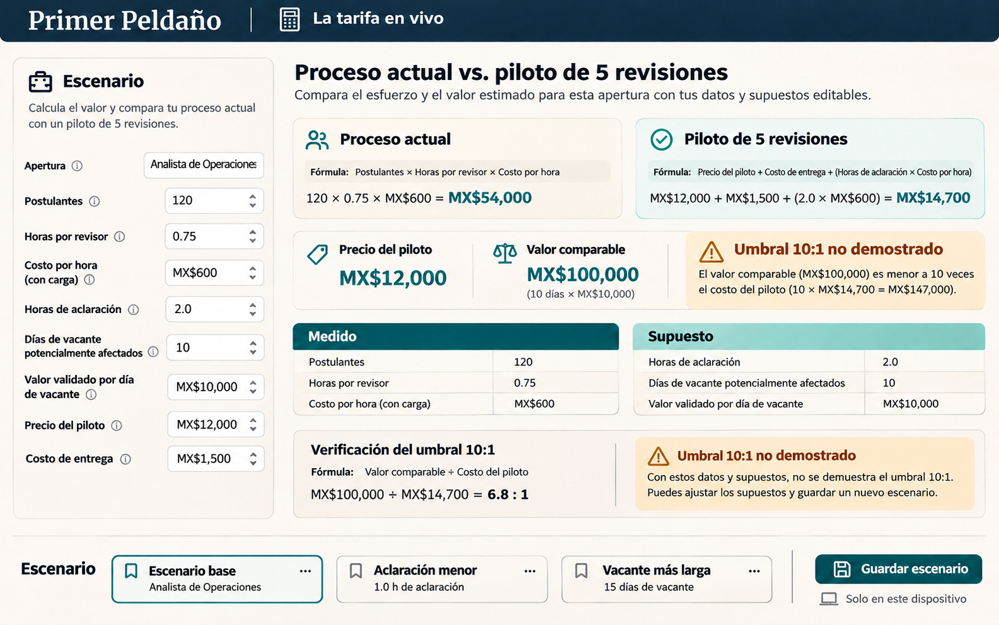
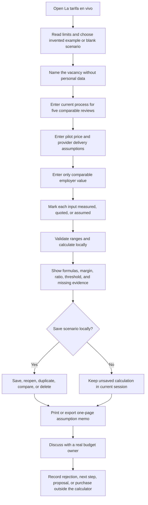
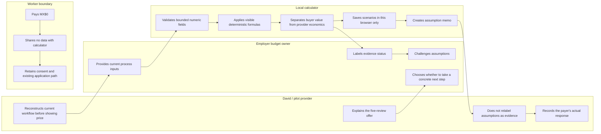

# Primer Peldaño - Week 14 build packet

**Milestone:** La tarifa en vivo 
**Prepared before Week 14 product code:** 12 November 2026 
**Owner:** David Buzali 
**Status:** Build contract; prices and benefits remain hypotheses until a real payer provides evidence.

## Problem in my words

Primer Peldaño can describe an ethical five-review pilot, but it cannot yet conduct an honest price conversation. A budget owner needs to compare the employer's current screening task with the proposed pilot using the same unit, visible formulas, and evidence status. Today the MX$12,000 price, MX$6,000 estimated delivery cost, five-review capacity, and MX$120,000 10:1 hurdle are assumptions rather than measured commercial results.

The Week 14 feature is therefore not a persuasive ROI widget. It is a **price-truth calculator** that can reveal when the case does not work. It reconstructs one current process, separates employer value from provider economics, saves alternative scenarios locally, and produces a compact assumption memo for a real conversation with a budget owner.

## Exact user

The primary user is the person at a Mexican employer who can authorize and fund a bounded hiring pilot for one named opening: an owner, operations leader, HR leader, or talent-acquisition budget holder. They know or can obtain the employer's loaded review cost, current screening time, clarification burden, and vacancy consequences.

The worker is the protected beneficiary, not the calculator operator and not the payer. The calculator must never ask for candidate names, evidence, age, salary history, disability, behavior, or any other personal record. Workers continue to pay MX$0.

## Success definition

Before the Week 14 module closes, an employer-side user can open the public URL, create a scenario for one vacancy, enter a like-for-like baseline for five comparable reviews, mark every input as **measured**, **quoted**, or **assumed**, and see:

- the current five-review screening cost;
- the MX$12,000 pilot price and the value required for a 10:1 case;
- estimated provider delivery cost, contribution, and contribution margin;
- comparable employer value and the resulting value-to-price ratio;
- a plain-language verdict that can explicitly say the 10:1 threshold is not demonstrated;
- the missing evidence that would make the scenario more credible.

The user can save, reopen, duplicate, rename, and delete scenarios in the same browser; compare up to three scenarios; reset all local data; and print or export a one-page memo. No scenario is transmitted anywhere. The default invented scenario must fail the 10:1 threshold so the product demonstrates honesty rather than sales theater.

## Image-generated mockup

The following mockup was generated before Week 14 product code. It is a design hypothesis, not evidence of value, demand, or working software. Its visible 6.8:1 result deliberately fails the 10:1 threshold.

## Feature flow

## Actor swimlane

## Benchmark line

**Best existing solution on Earth for this feature:** Upwork's Cost of Vacancy Calculator turns a small set of employer inputs into a visible vacancy-cost estimate and publishes its calculation method and limits.

**How Primer Peldaño differs or localizes:** La tarifa en vivo uses MXN, compares the same five-review task on both sides, separates buyer value from provider margin, attaches an evidence status to every input, saves scenarios locally, and refuses to turn vacancy value into a hiring promise or worker score.

The broader product benchmark remains Opportunity@Work's STARs Hiring Playbook, which helps employers replace pedigree screens with skills-first practices. CONOCER remains the strongest Mexican institutional comparator for formally recognizing competence learned through formal, informal, or empirical routes; Primer Peldaño does not certify or replace it.

Primary references:

- [Upwork - Cost of Vacancy Calculator](https://www.upwork.com/tools/cost-of-vacancy-calculator)
- [Greenhouse - What is cost per hire?](https://www.greenhouse.com/uk/resources/glossary/what-is-cost-per-hire)
- [Opportunity@Work - STARs Hiring Playbook](https://www.opportunityatwork.org/take-action/psh/public-sector/stars-hiring-playbook)
- [CONOCER - How to certify competencies](https://conocer.gob.mx/certifico-mis-competencias/)

## Three-year long view

If this slice works, Primer Peldaño becomes a worker-controlled evidence infrastructure with a credible commercial layer: employers can price one bounded review commitment before asking workers to invest effort. Over three years, comparable scenarios and real pilot outcomes could reveal which openings, evidence standards, and delivery models create value without ranking people or selling their records. The product succeeds only if commercial growth strengthens worker agency, pays for careful human review, and leaves unsupported claims visible rather than smoothing them away.

## Scope cut

This week does **not** build payments, invoices, contracts, CRM, employer accounts, cloud sync, multi-user collaboration, production analytics, candidate intake, evidence upload, identity verification, certification, reviewer assignment, employer messaging, hiring recommendations, or automatic pricing. It does not calculate an individual's economic worth, predict a hire, rank candidates, estimate a worker's salary, or promise that reducing screening time reduces vacancy duration.

The tool does not claim that MX$12,000 is accepted, that MX$6,000 is the real delivery cost, that five reviews are sufficient, or that MX$120,000 of value exists. A genuine payer conversation and any purchase decision happen outside the app and must be documented without invention.

## Pricing model and formulas

All monetary fields use MXN. Calculations run in the browser with ordinary deterministic arithmetic.

| Output | Formula | Interpretation |
|---|---|---|
| Current comparable cost | `(review hours per case x 5 + clarification hours) x loaded employer hourly cost + current external costs` | Cost of the same bounded five-case task, not the employer's entire hiring process. |
| Pilot price | User-entered price; invented default `MX$12,000` | Amount the employer would pay. It is not provider revenue evidence until purchased. |
| Required value at 10:1 | `pilot price x 10` | Threshold only; never a demonstrated return by default. |
| Provider delivery cost | `delivery hours x delivery hourly cost + tools/admin` | Seller-side estimate kept separate from buyer value. |
| Contribution | `pilot price - delivery cost` | Before fixed costs, sales, taxes, and development. |
| Contribution margin | `contribution / pilot price` | Invalid when pilot price is zero. |
| Comparable employer value | `validated time saved x loaded hourly cost + validated other value` | Includes only benefits the payer can explain and defend; vacancy value is optional and assumed unless measured. |
| Value-to-price ratio | `comparable employer value / pilot price` | Shows `not demonstrated` whenever inputs are incomplete, invalid, or the ratio is below 10. |

The initial commercial floor is MX$10,000 only if the MX$6,000 delivery-cost assumption holds; that would produce a 40% contribution margin before fixed costs. The calculator must show the dependency rather than present the floor as fact.

## Shadow clause

- Paying more never buys more worker data, hidden rankings, behavioral analytics, or cross-opening reuse.
- The calculator accepts process economics only; no candidate or employee personal data is allowed.
- A saved scenario stays on the current device unless the user deliberately exports it.
- The pilot price buys a bounded process: five human reviews, declared criteria, worker-authorized submissions, criterion-linked decisions, and a response deadline.
- The existing application path remains available with the same deadline and review standard.
- Any claim that the pilot changes vacancy duration, quality of hire, retention, or revenue must be marked assumed until measured against a comparable baseline.
- A failed 10:1 result is a valid output and must never be visually hidden, softened, or auto-corrected.

## Architecture and free stack

| Layer | Choice | Week 14 boundary |
|---|---|---|
| App | Next.js 16 + React 19 + TypeScript | New pricing route inside the preserved Primer Peldaño interface. |
| Styling | Tailwind CSS 4 | Responsive, keyboard-accessible editorial interface; status never depends on color alone. |
| Calculation | Pure deterministic TypeScript module | Decimal-safe money helpers, visible formulas, no AI, no hidden coefficients. |
| Validation | Typed allow-list and field-level constraints | Bounded labels and numeric ranges; reject NaN, Infinity, negative values, and overlong text. |
| Persistence | Versioned browser `localStorage` | Up to 20 scenarios, no sync, no personal data, explicit delete/reset/export. |
| Export | Print stylesheet plus JSON backup | One-page decision memo and portable scenario data; user initiated only. |
| Data | No production database | No auth required because no personal or server-side data is stored. |
| Hosting | Vercel | Dedicated Week 14 project and deployment history. |
| Source | Dedicated GitHub repository | Separate from Week 13; at least five ordered Week 14 commits. |

## Scenario data boundary

Allowed fields are: scenario ID, schema version, created/updated timestamps, bounded vacancy label, five-review baseline inputs, pilot price, provider-cost inputs, employer-value inputs, evidence status per input, and an optional 240-character assumption note. Disallowed fields include person names, contact information, employer secrets, candidate evidence, protected characteristics, free-form resumes, browser fingerprints, IP addresses, and analytics identifiers.

## Test plan

### Mechanical pass

1. Unit-test every formula, rounding rule, zero-price guard, margin boundary, and evidence-status verdict.
2. Test field limits, invalid numbers, empty required values, schema migration, corrupted local data, 20-scenario cap, duplicate, delete, reset, export, and import rejection.
3. Add contract tests that fail if candidate-data fields, a global candidate score, or a default 10:1 success claim appears.
4. Run tests, type checking, lint, production build, and a tracked-secret scan.
5. Deploy release 1 to a dedicated Week 14 Vercel project and verify anonymous desktop and 390 x 844 mobile access.
6. Exercise the complete live flow, record at least one real defect, fix it, rerun all checks, and deploy release 2.

### Persona pass

Use a fresh independent chat with an invented owner of a 35-person Mexican manufacturing business who is comfortable with spreadsheets but skeptical of HR software, reads slowly on a phone, and will abandon a tool if it mixes cash cost with speculative value. Show screenshots in order, ask the persona to complete one scenario without coaching, record every hesitation, and fix the highest-consequence confusion. Label the result synthetic; it is not payer evidence.

### Real payer conversation

Ask one real budget owner to reconstruct their current five-case screen before revealing the product or price. Then present the exact MX$12,000 five-review offer and request a concrete next step. Record rejection, partial interest, requested proposal, pilot refusal, signed agreement, or payment neutrally. A hypothetical yes is not demand.

## Acceptance criteria

- The public route loads anonymously and uses invented defaults visibly labeled as such.
- The calculator compares exactly five current reviews with exactly five pilot reviews by default.
- Every editable business input has a visible measured, quoted, or assumed status.
- All formulas and included/excluded costs are visible in plain Spanish.
- Employer value, employer cost, provider delivery cost, and provider contribution remain separate.
- The default scenario does not meet 10:1 and explains what evidence is missing.
- The MX$120,000 threshold updates directly from the pilot price.
- Scenarios can be saved, reopened, duplicated, compared, renamed, deleted, exported, and reset locally.
- Corrupted or outdated local data fails safely without losing valid scenarios.
- No scenario is transmitted, and no candidate or worker data is requested or stored.
- No ranking, match percentage, hiring prediction, or automated recommendation appears.
- The interface works by keyboard, survives 200% zoom, and has no horizontal overflow at 390 px.
- At least one documented mechanical defect and one persona confusion are fixed before deployment 2.
- GitHub and Vercel resources are dedicated to Week 14; Week 13 remains intact.

## Commit and deployment sequence

1. **Packet before code:** packet, generated mockup, implementation prompt, and Week 14 decision entry.
2. **Calculator core:** typed scenario model, validation, pure formulas, and unit tests.
3. **Working interface:** responsive calculator, evidence statuses, threshold verdict, and formula disclosure; deploy release 1.
4. **Saved scenarios:** local persistence, compare, duplicate, delete, reset, print, and export.
5. **Test fix:** document a real live defect and the fresh persona confusion, fix the highest-consequence issue, and deploy release 2.
6. **Submission evidence:** final decision log, testing record, persona log, build transcript, demo script, PDFs, live URL, and repository link.

## Evidence still required

- A real budget owner's current five-case screening baseline.
- A real payer response to the MX$12,000 offer.
- Measured delivery hours and tools/admin cost.
- Comparable outcomes showing whether the pilot changes reviewer effort, clarification, decision usefulness, vacancy time, or later employment outcomes.
- Fresh persona-test observations and the resulting fix.
- Two verified Week 14 deployments.

Until those events occur, the calculator is a disciplined conversation instrument, not proof of demand, profitability, or a 10:1 return.
